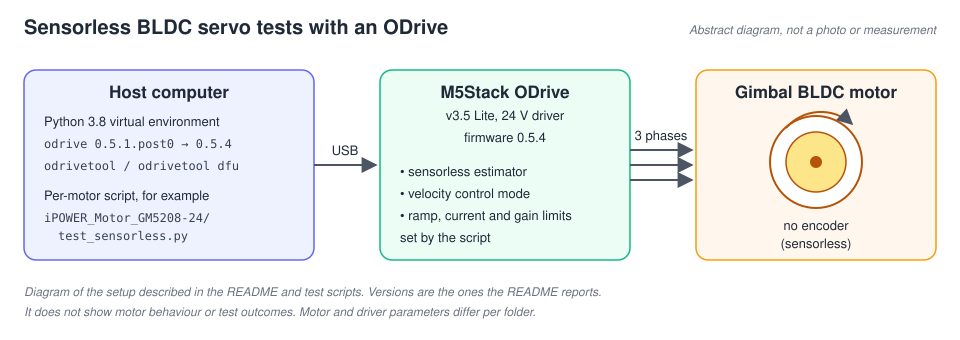

# ODrive sensorless motor experiments

[](#setup-and-use)
[](docs/odrive-setup-record.md)
[](LICENSE)

This repository stores per-motor ODrive configuration scripts for experiments with sensorless
velocity control of gimbal BLDC motors. Each script configures axis 0, requests closed-loop
control, waits for startup and commands a fixed velocity. The purpose is to retain the parameter
sets used while investigating whether these motors could run without encoder feedback.



*Setup schematic, not a photograph or a measurement of motor behavior.*

## Available configurations

The tracked folders are:

- [iPOWER_Motor_GM5208-24/](iPOWER_Motor_GM5208-24/)
- [iPOWER_Motor_GM2804/](iPOWER_Motor_GM2804/)
- [iPOWER_Motor_GM4109/](iPOWER_Motor_GM4109/)
- [MiToot_2804_100KV/](MiToot_2804_100KV/)
- [MiToot_2206_100T/](MiToot_2206_100T/)

Each folder contains `test_sensorless.py`. These are hardware-control experiments rather than
assertion-based tests. The folder names identify the recorded configurations; their presence
does not establish that every motor completed a successful test.

The scripts set motor type, pole pairs, resistance, current limits, flux linkage, sensorless
startup ramp and velocity controller gains. They use `dev0` and enum constants supplied by an
`odrivetool` session. They modify live device state and can start the connected motor; they do
not automatically stop it or save a measurement file.

## Setup and use

The historical setup used an M5Stack ODrive v3.5 Lite 24 V module and firmware 0.5.4. The original
setup notes used Linux and Python 3.8 and reported communication problems with other package
versions. See the [setup and firmware-update record](docs/odrive-setup-record.md) for that sequence;
it is not a verified procedure for current ODrive hardware or firmware.

The following environment commands describe the recorded firmware setup and were not executed
for this review. Availability with current package tooling was not verified:


```bash
python3.8 -m venv .venv
source .venv/bin/activate
python -m pip install odrive==0.5.4
odrivetool
```

Before executing a script, review its voltage/current limits, resistance, pole pairs, requested
speed, startup ramp and braking/regeneration settings against the actual motor and supply. In
particular, the source sets `pre_calibrated = True` instead of performing calibration. From the
interactive tool, use the absolute path to the chosen configuration, for example:

```python
exec(open('/path/to/servo_tests/iPOWER_Motor_GM5208-24/test_sensorless.py').read())
```

Have a physical power cutoff available and keep the motor/load secured before launching a script.
To request zero velocity in the same session, use `dev0.axis0.controller.input_vel = 0`. That uses
the same velocity-command field as the scripts; the stop behavior and stopping distance were not
validated for this review. The scripts do not call `save_configuration()` or `erase_configuration()`
and do not request persistence themselves.

This describes the scripts' intended execution context; it was not run for this documentation
revision. Do not run them with plain `python test_sensorless.py`, where `dev0` and the ODrive
constants are undefined.

## Validation and limitations

Review date: 2026-11-12.

This revision inspected all five scripts and their configuration values. No controller was
connected, no firmware was changed and no motor was run. The repository contains no measured
speed/current traces, pass/fail criteria or saved results demonstrating stable sensorless control.
The firmware/version notes are a historical setup account, not an automated compatibility matrix.
macOS support has not been verified.

The scripts configure one axis and issue an open-ended velocity command. They do not implement
encoder feedback, a measurement loop, fault analysis or an automatic shutdown sequence. Parameters
must be evaluated separately for each physical setup.

## Attribution and license

The original scripts and [MIT license](LICENSE) are retained without code changes.
